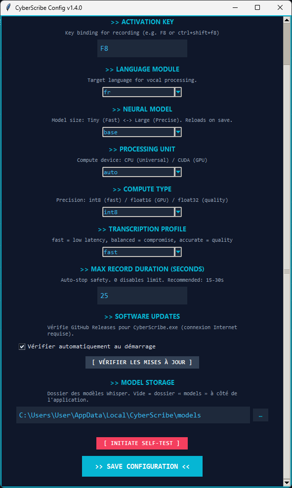

# CyberScribe

**CyberScribe** is a local, offline voice transcription tool for Windows, powered by `faster-whisper`. It lives in the system tray, records from a global hotkey, transcribes on-device, then pastes the text into the active window.



## Features

- **Offline transcription**: Faster-Whisper, models stored next to the app. No cloud.
- **Global hotkey**: Toggle recording from anywhere (default `F8`). Combinations like `ctrl+shift+f8` are supported, and mouse side buttons (`X1` / `X2`) or middle-click can be bound via live capture in Configuration.
- **Recording overlay**: A compact always-on-top indicator while you speak.
- **Audio feedback**: Beeps on start and stop.
- **Auto-paste**: Copies the transcript and sends Ctrl+V to the focused window.
- **Anti-latency profiles**: Fast, Balanced, Accurate.
- **Smart device detection**: Automatic CUDA (NVIDIA GPU) or CPU.
- **Auto-stop safety**: Configurable maximum recording duration.
- **Pre-buffer (anti clip)**: Optional rolling microphone buffer so speech at the first instant after F8 is not cut off (see `pre_buffer_ms` in config).
- **Single instance**: A second launch is refused so hotkeys do not collide.
- **In-app updates** (Windows EXE): Optional check against GitHub Releases; downloads and swaps `CyberScribe.exe` in place while keeping `config.json` and your models folder. Install prompts show the release SHA256 (verified when `CyberScribe.exe.sha256` is published; a missing sidecar warns but does not block). Configuration shows this executable's SHA256.
- **Configurable model storage**: Choose where Whisper weights live; moving the folder can migrate existing downloads (move or copy).
- **Windows installer**: Inno Setup package with separate models directory (default under `%LOCALAPPDATA%`).

## Requirements

- Windows 10/11
- A microphone
- Optional: NVIDIA GPU + current drivers for CUDA acceleration

## Installation / Compilation

### Local Development

```bash
pip install -r requirements.txt
python CyberScribe.py
```

### Build your own EXE

```bash
pip install -r requirements.txt pyinstaller
pyinstaller --noconsole --onefile --noconfirm --hidden-import=updater --hidden-import=models_storage --hidden-import=dictation_pipeline --hidden-import=audio_wav --hidden-import=audio_pre_buffer --hidden-import=audio_devices --hidden-import=cyber_config --hidden-import=hotkey_util --hidden-import=settings_ui --hidden-import=first_run_ui --hidden-import=ui_theme --hidden-import=ui_widgets --hidden-import=overlay_ui --hidden-import=overlay_placement --hidden-import=pyaudio --hidden-import=pynput.keyboard._win32 --hidden-import=pynput.mouse._win32 --add-data "venv\Lib\site-packages\faster_whisper\assets\silero_vad_v6.onnx;faster_whisper/assets" --icon "app.ico" --name "CyberScribe" CyberScribe.py
```

*(Adjust the path to `silero_vad_v6.onnx` according to your Python environment.)*

## CI/CD (Automated Builds)

This repository uses **GitHub Actions**. Pushing a `v*` tag builds `CyberScribe.exe`, an **Inno Setup** installer (`CyberScribe-Setup-<version>.exe`), and SHA256 sidecars on Windows, then attaches them to the GitHub Release.

The installer lets you pick the install folder and the **Whisper models directory** (default `%LOCALAPPDATA%\CyberScribe\models`). You can change the models path later in Configuration; existing downloads can be **moved or copied** to the new folder.

### Windows SmartScreen

Releases are **not Authenticode-signed** yet, so Windows may show *“Windows protected your PC”* when you run `CyberScribe-Setup-*.exe` or the portable `CyberScribe.exe`. That does not mean the install failed — it is the default behavior for unsigned software.

1. Download only from the [GitHub Releases](https://github.com/nico2511/CyberScribe/releases) page for this project.
2. On the SmartScreen dialog: **More info** → **Run anyway** (labels may vary slightly by Windows version).
3. The in-app updater checks **SHA256** against `CyberScribe.exe.sha256` when that file is published on the release, and shows the checksum before you install.

Removing the warning for everyone requires a **code-signing certificate** on the EXE and installer (see [`docs/AUDIT_PRODUIT.md`](docs/AUDIT_PRODUIT.md)).

## Usage

1. Run the executable (or `python CyberScribe.py`).
2. Wait until the tray tooltip says **Prêt** — the Whisper model may still be loading on first launch.
3. Press **F8** (or your configured hotkey) to start recording. You will hear a high beep and see the overlay.
4. Press the hotkey again to stop. The transcribed text is pasted into the active window.
5. Open **Configuration** from the tray icon to change hotkey, language, model, device, compute type, profile, and max duration. For the activation key, click **Capturer** then press a key combo or a mouse button (side `X1`/`X2` or middle) — no need to type the binding. Changing the model or device reloads Whisper in the background.

### `pre_buffer_ms` (speech at F8)

By default the app keeps about **1 second** of microphone audio in memory (never written to disk except as part of a normal recording WAV, and never logged). When you press F8, that pre-roll is prepended to the capture so the first syllable is less likely to be clipped.

In `config.json`:

| Value | Behavior |
|-------|----------|
| `1000` (default) | ~1 s pre-roll at 16 kHz mono |
| `0` | Disabled — recording starts only on F8 press (previous behavior) |
| `1`–`3000` | Custom pre-roll length in milliseconds |

**`max_record_seconds`**: The auto-stop timer still counts **only live capture** from the moment you press F8. The final WAV length is up to `pre_buffer_ms` + `max_record_seconds` of audio. Set `pre_buffer_ms` to `0` if you want the WAV capped strictly at `max_record_seconds`.

If the microphone cannot stay open in the background (or pre-buffer is `0`), CyberScribe falls back to on-demand capture without error.

## Privacy

Transcription runs entirely on your machine. Application logs record events and error messages, never the dictated text.

## Tests and latency bench

See [`docs/TESTING.md`](docs/TESTING.md) for running unit tests (model-free tests always run; Whisper fixture tests skip when no local `tiny` cache) and `bench_dictation_latency.py` for min/median/max latency per profile.

Optional pipeline timing in `config.json`: `"log_pipeline_timings": true` logs only durations and metadata after each dictation.

## Project status

Current release line: **v1.5.6** (harder post-update relaunch; prior: transcription PyAV fix). Product audit: [`docs/AUDIT_PRODUIT.md`](docs/AUDIT_PRODUIT.md). Copy `config.example.json` to `config.json` for a starting config.

## Support

If you like CyberScribe, consider supporting the project!

**Bitcoin (BTC)**: `bc1pt20cczcmvukrny4pru3x2nc522tk2sectlu22d42q2ltyau7t66suh6kqx`
